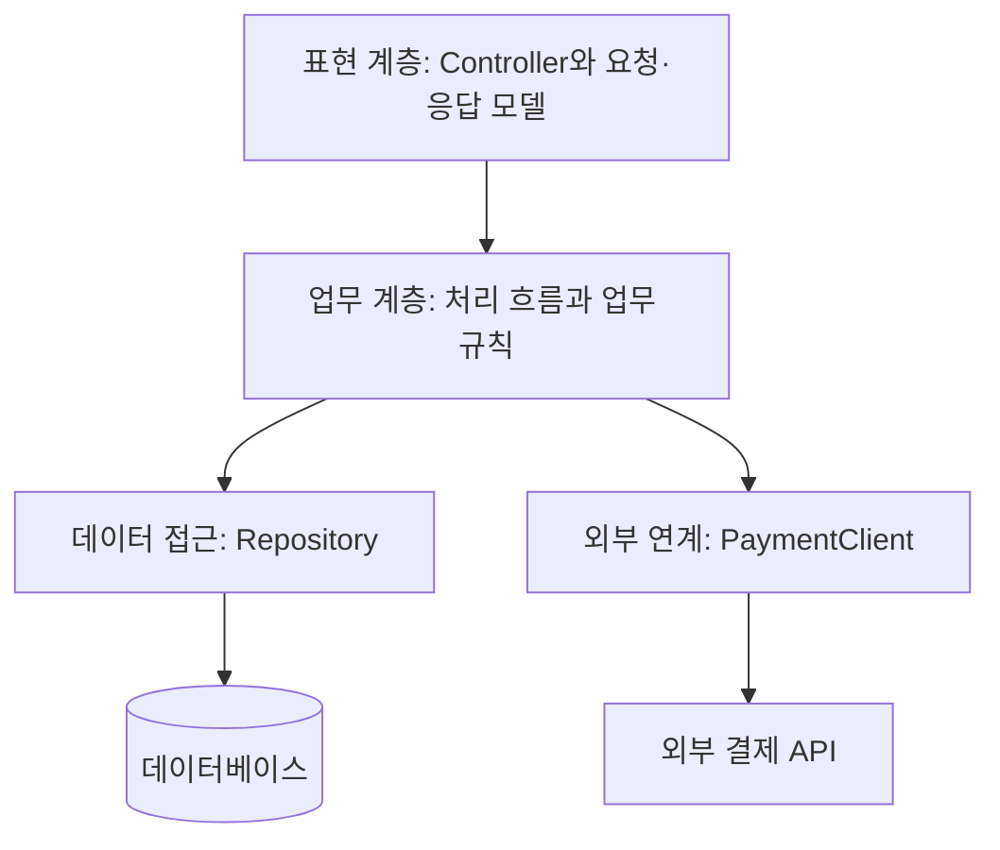

# 계층형 구조: 요청 처리와 업무 규칙, 저장 책임 나누기

| 항목 | 내용 |
|---|---|
| 버전 | v0.1 |
| 상태 | 초안 |
| 수정일 | 2026-11-09 |
| 작성자 | Codex |

## 목차

1. [계층형 구조를 이해하는 기준](#계층형-구조를-이해하는-기준)
2. [계층별 책임과 의존성](#계층별-책임과-의존성)
3. [주문 기능에 적용한 예](#주문-기능에-적용한-예)
4. [트랜잭션과 외부 호출 경계](#트랜잭션과-외부-호출-경계)
5. [적용 조건과 대안](#적용-조건과-대안)
6. [흔한 문제와 점검 방법](#흔한-문제와-점검-방법)
7. [관련 문서와 근거](#관련-문서와-근거)

## 계층형 구조를 이해하는 기준

계층형 구조는 코드를 역할별로 나누고 계층 사이의 호출 규칙을 정하는 방식입니다. 대표적으로 요청·응답을 처리하는 표현 계층, 업무 흐름과 규칙을 다루는 업무 계층, 저장소 접근을 담당하는 데이터 접근 계층을 구분합니다.

**계층을 나누는 목적은 변경 이유를 분리하는 것입니다.** 화면 요청 형식이 달라졌을 때 결제 규칙을 수정하지 않고, 저장 방식이 바뀌었을 때 API 응답 계약까지 함께 바꾸지 않도록 경계를 만듭니다.

여기서 논리적인 코드 계층인 **layer**와 물리적인 배포 단위인 **tier**는 다릅니다. 여러 계층이 하나의 프로세스에 있을 수 있으며, 계층마다 서버를 따로 둘 필요는 없습니다. 이 구분과 개방형·폐쇄형 계층의 의미는 [Microsoft N-tier 아키텍처 설명](https://learn.microsoft.com/en-us/azure/architecture/guide/architecture-styles/n-tier)을 참고합니다.

## 계층별 책임과 의존성

다음은 전통적인 하향 의존 구조를 단순화한 예입니다. 외부 결제 연계는 저장소와 별도의 기술 접근 책임으로 표시했습니다.



| 역할 | 담당하는 일 | 다른 곳에 둘 일 |
|---|---|---|
| 표현 계층 | 입력 형식 검사, 인증된 사용자 전달, HTTP 응답과 오류 변환 | 결제 가능 여부와 주문 상태 전이 규칙 |
| 업무 처리 흐름 | 하나의 사용 사례를 수행하고 저장·외부 연계를 조정 | HTTP 헤더 처리, SQL 작성 |
| 업무 규칙 | 금액·수량 조건, 허용된 상태 전이 등 업무상 제약 | 네트워크 요청, 데이터베이스 연결 관리 |
| 데이터 접근 | 조회·저장과 데이터 매핑, 저장소별 오류 처리 | 사용자 응답 형식과 결제 승인 판단 |
| 외부 연계 | 결제 계약에 맞는 호출, 응답 변환, 연계 오류 구분 | 주문의 최종 상태를 임의로 변경하는 정책 |

업무 처리 흐름과 업무 규칙을 반드시 다른 배포 단위로 나눌 필요는 없습니다. 처음에는 같은 업무 계층 안에서도 충분하며, 규칙이 복잡해질 때 별도 객체로 분리할 수 있습니다.

### 호출 규칙을 먼저 정합니다

이 예제에서는 Controller가 업무 처리 흐름을 호출하고, 업무 처리 흐름이 Repository와 PaymentClient를 호출합니다. Controller에서 Repository를 직접 호출하거나 Repository가 Controller를 참조하는 코드는 허용하지 않는 규칙을 사용합니다.

바로 아래 계층만 거치게 하는 폐쇄형과 필요한 하위 계층을 직접 사용하는 개방형 중 어느 쪽을 택할지는 팀에서 정해야 합니다. 이름만 계층으로 나누고 예외를 무제한 허용하면 책임이 다시 섞이기 때문입니다.

## 주문 기능에 적용한 예

다음 폴더는 설명용 구조이며 저장소에 구현된 애플리케이션이 아닙니다. 최상위는 기능으로 묶고 그 안에서 계층을 구분하면 주문 관련 변경을 한곳에서 추적하기 쉽습니다.

```text
src/
└── orders/
    ├── presentation/
    │   ├── order-controller.ts       요청 검사와 응답 변환
    │   └── order-dto.ts              API 입력·출력 형식
    ├── business/
    │   ├── order-service.ts          주문 생성과 결과 반영 흐름
    │   └── order.ts                  주문 상태와 전이 규칙
    ├── persistence/
    │   └── order-repository.ts       주문 관련 조회와 저장
    └── integration/
        └── payment-client.ts        외부 결제 계약 변환
```

### 주문 생성의 역할 분담

1. **Controller**가 요청 필드의 형식을 검사하고 인증된 사용자 ID를 Service에 전달합니다. 사용자 ID와 가격을 요청 본문에서 받은 그대로 신뢰하지 않습니다.
2. **Service**가 기존 요청 키를 확인하고, 서버가 확인한 가격으로 주문을 구성합니다. 주문과 결제 시도를 함께 저장하도록 트랜잭션을 조정합니다.
3. **Order**가 주문 항목과 상태 전이의 업무 규칙을 확인합니다. 이 객체는 HTTP 요청이나 데이터베이스 연결을 알 필요가 없습니다.
4. **Repository**가 실제 저장을 수행합니다. 동시 요청의 유일성 충돌은 Service가 기존 결과를 찾을 수 있도록 구분해 전달합니다.
5. **PaymentClient**가 저장 완료 후 외부 승인을 요청합니다. Service는 확인된 결과를 주문에 반영하고 Controller는 응답 형식으로 변환합니다.

같은 값 검사가 여러 위치에 있다고 모두 중복은 아닙니다. API의 형식 검사는 호출자에게 빠른 오류를 알려 주고, 업무 규칙 검사는 다른 진입점에서도 규칙을 지키게 하며, 데이터베이스 제약은 동시 실행과 우회 쓰기로부터 저장 상태를 보호합니다.

## 트랜잭션과 외부 호출 경계

계층형 구조만 도입한다고 트랜잭션이 자동으로 올바르게 나뉘지는 않습니다. 어떤 저장을 함께 성공·실패시킬지는 사용 사례의 업무 조건으로 정합니다.

| 단계 | 처리 범위 | 설계 이유 |
|---|---|---|
| 주문 준비 | 주문·주문 항목·결제 시도를 하나의 내부 트랜잭션으로 저장합니다. | 주문만 있고 결제 추적 정보가 없는 상태를 피합니다. |
| 외부 승인 | 내부 트랜잭션이 끝난 뒤 결제 API를 호출합니다. | 외부 응답 대기 동안 내부 잠금을 오래 유지하지 않습니다. |
| 결과 반영 | 결제 결과와 주문 상태를 새 내부 트랜잭션으로 갱신합니다. | 확인된 결과와 주문 상태를 함께 반영합니다. |

Controller가 먼저 저장하고 Service가 나중에 결제한다는 식으로 업무 흐름을 여러 계층에 흩뜨리지 않습니다. Service가 흐름을 관리하되, 실제 외부 호출과 저장의 기술 처리는 각 담당 객체에 맡깁니다.

결제 시간 초과나 프로세스 종료를 다루는 전체 복구 방식은 [전체 흐름 설계](<../../../solution/[draft]03-end-to-end-design.md#실패와-중복-요청-처리>)에 정리했습니다. 호출을 재시도할 때는 저장된 거래 키와 기존 결과를 이용해야 하며, 단순히 새 결제를 만드는 방식으로 복구하지 않습니다.

## 적용 조건과 대안

계층형 구조는 요청 처리·업무·저장의 책임을 설명하고 팀의 호출 규칙을 맞추는 출발점으로 사용할 수 있습니다. 다만 아래 비교는 이 예제를 바탕으로 한 설계 검토 관점이며, 특정 규모의 시스템에 한 구조를 일괄 권장하는 기준은 아닙니다.

| 상황 | 검토할 방향 |
|---|---|
| 업무와 저장 처리가 비교적 단순합니다. | 계층 수를 최소화하고 실제 책임이 있는 객체만 둡니다. |
| Service 하나에 여러 업무가 계속 추가됩니다. | 기능·사용 사례별로 나누고 공통 업무 규칙의 소유자를 정합니다. |
| 저장소나 외부 API가 업무 코드에 강하게 스며듭니다. | [Hexagonal / Clean](hexagonal-clean/README.md)의 경계와 의존성 역전을 함께 검토합니다. |
| 기능 하나를 바꿀 때 여러 공통 계층이 함께 흔들립니다. | 기능 중심으로 변경을 모으는 Vertical Slice를 검토합니다. |
| 여러 기능을 같은 배포 단위에서 독립적으로 관리해야 합니다. | [Modular Monolith](../01-01-system-structure/modular-monolith/README.md)의 모듈 경계를 함께 검토합니다. |

계층형 구조와 모듈 구분은 함께 사용할 수 있습니다. 반면 서비스의 독립 배포 여부는 코드 계층과 다른 결정이므로, 계층 분리가 곧 MSA 전환을 의미하지는 않습니다.

## 흔한 문제와 점검 방법

| 문제 | 나타나는 증상 | 확인할 방법 |
|---|---|---|
| Controller에 업무 규칙이 모입니다. | 배치·관리자 기능에서 같은 규칙을 다시 구현합니다. | HTTP 없이 업무 처리를 호출해도 규칙이 적용되는지 확인합니다. |
| Service가 모든 일을 합니다. | SQL, 요청 객체, 외부 응답 형식이 한곳에 섞입니다. | 각 변경 이유를 분리하고 필요한 경계를 명시합니다. |
| 계층이 전달만 반복합니다. | 이름만 다른 메서드가 인자를 그대로 넘깁니다. | 해당 계층이 실제 정책·변환·경계를 제공하는지 검토합니다. |
| 저장 모델을 API에 그대로 노출합니다. | 컬럼 변경이 외부 응답 변경으로 이어집니다. | API 입력·출력 모델과 저장 매핑을 분리합니다. |
| 계층 역참조가 생깁니다. | 하위 객체가 상위 Controller나 요청 객체를 요구합니다. | import 방향과 순환 의존성을 확인합니다. |

검증도 책임에 맞춰 나눕니다. 업무 규칙은 네트워크 없이 확인하고, Repository는 실제 데이터베이스 제약과 함께 검증하며, 외부 연계는 계약과 오류 변환을 확인합니다. 마지막으로 정상 처리·중복 요청·시간 초과를 전체 흐름으로 검증합니다.

## 관련 문서와 근거

- [전체 흐름 설계](<../../../solution/[draft]03-end-to-end-design.md>): 계층 밖의 외부 시스템과 복구 흐름까지 연결합니다.
- [데이터 모델링과 소유권](<../../data/[draft]01-modeling-and-ownership.md>): 저장 구조와 변경 책임을 구체화합니다.
- [Microsoft N-tier 아키텍처](https://learn.microsoft.com/en-us/azure/architecture/guide/architecture-styles/n-tier): layer·tier, 계층 호출 방식의 개념을 확인하는 자료입니다. 이 문서의 주문 예제와 폴더 구성은 별도의 설명용 설계입니다.

[애플리케이션 아키텍처 안내](../README.md) · [전체 문서 안내](../../../README.md)
