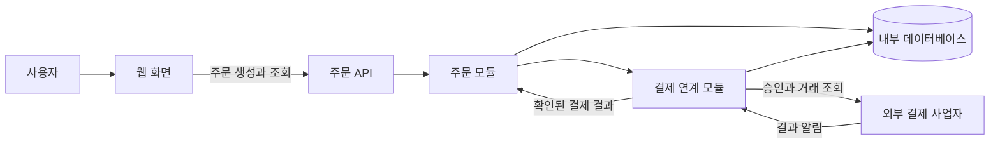

# 전체 흐름 설계: 주문 요청부터 결제 결과 반영까지

| 항목 | 내용 |
|---|---|
| 버전 | v0.1 |
| 상태 | 초안 |
| 수정일 | 2026-11-09 |
| 작성자 | Codex |

## 목차

1. [이 문서로 정리할 것](#이-문서로-정리할-것)
2. [예제의 범위와 가정](#예제의-범위와-가정)
3. [구성요소와 책임](#구성요소와-책임)
4. [정상 처리 흐름](#정상-처리-흐름)
5. [실패와 중복 요청 처리](#실패와-중복-요청-처리)
6. [운영과 전환 시 확인할 것](#운영과-전환-시-확인할-것)
7. [설계 완료 점검](#설계-완료-점검)
8. [관련 문서와 근거](#관련-문서와-근거)

## 이 문서로 정리할 것

전체 흐름 설계는 하나의 사용자 요청이 어떤 구성요소를 거쳐 처리되고, 어디에 결과가 남으며, 실패했을 때 어떻게 회복하는지 설명하는 문서입니다. 구성도에 서버 이름을 적는 것에서 끝내지 않고 **책임·계약·상태 변화·실패 대응**을 연결해야 구현과 운영에 사용할 수 있습니다.

이 문서는 주문과 외부 결제를 예로 든 솔루션 설계 입문 자료입니다. 여기서 시스템 전체의 흐름을 확인한 뒤 [계층형 구조](<../domains/application/02-02-application-structure/[draft]01-layered.md>)에서 코드의 책임을, [데이터 모델링과 소유권](<../domains/data/[draft]01-modeling-and-ownership.md>)에서 저장 구조를 이어서 살펴볼 수 있습니다.

## 예제의 범위와 가정

아래는 설명을 위한 가상 설계입니다. 실제 프로젝트의 확정 요구사항이나 구현 결과가 아닙니다.

| 구분 | 예제에서 정한 조건 |
|---|---|
| 사용자 기능 | 주문 생성과 주문 상태 조회를 제공합니다. |
| 내부 구성 | 하나의 백엔드 안에 주문 모듈과 결제 연계 모듈을 둡니다. |
| 저장소 | 내부 데이터는 하나의 관계형 데이터베이스에 저장합니다. |
| 외부 의존성 | 외부 결제 사업자가 승인·취소·거래 조회 기능을 제공합니다. |
| 결제 계약 | 동일 거래 키로 중복 승인을 방지하고, 결과 알림의 진위를 검증할 수 있다고 가정합니다. |
| 제외 범위 | 재고 예약, 배송, 할인, 세금, 환불 정책의 상세 설계는 제외합니다. |

내부 모듈은 같은 프로세스에 있어도 변경 책임을 나눕니다. 외부 결제는 내부 데이터베이스 트랜잭션에 포함할 수 없으므로, 주문 저장과 결제 승인 사이의 불일치를 별도로 다뤄야 합니다.

## 구성요소와 책임

이 그림은 기능별 관계를 보여 주는 개념도입니다. 상자마다 독립 서버나 서비스를 배포한다는 의미는 아닙니다. 설명 수준을 나눌 때는 시스템 경계와 내부 구성을 구분하는 [C4 다이어그램 안내](https://c4model.com/diagrams)를 참고할 수 있습니다.

| 구성요소 | 맡는 책임 | 경계에서 정할 계약 |
|---|---|---|
| 웹 화면 | 요청 키를 유지하며 주문을 제출하고 결과를 표시합니다. | 처리 중·성공·실패를 사용자에게 어떻게 보여 줄지 |
| 주문 API | 인증된 사용자 식별, 입력 형식 검사, 응답 변환을 담당합니다. | 요청 필드, 오류 형식, 주문 조회 권한 |
| 주문 모듈 | 주문 생성과 상태 전이 규칙을 소유합니다. | 중복 요청 판정, 확정·실패 조건 |
| 결제 연계 모듈 | 외부 계약을 내부 결과 형식으로 변환하고 거래를 추적합니다. | 거래 키, 시간 제한, 결과 조회, 알림 검증 |
| 내부 데이터베이스 | 주문·항목·결제 시도와 처리 기록을 보존합니다. | 키와 제약조건, 원자적으로 저장할 범위 |

## 정상 처리 흐름

1. **주문을 요청합니다.** 화면은 사용자 요청마다 요청 키를 만들고 재전송할 때 같은 키를 사용합니다. API는 로그인 상태와 입력 형식을 확인합니다.
2. **주문을 먼저 기록합니다.** 주문 모듈은 서버가 확인한 상품·가격으로 주문, 주문 항목, 결제 시도를 생성합니다. 같은 트랜잭션에서 상태를 `PENDING_PAYMENT`로 저장합니다.
3. **외부 결제를 요청합니다.** 내부 트랜잭션을 커밋한 뒤 결제 연계 모듈이 저장된 결제 시도의 거래 키로 승인을 요청합니다. 외부 응답을 기다리는 동안 데이터베이스 잠금을 유지하지 않습니다.
4. **확인된 결과를 반영합니다.** 승인 결과의 주문·금액·거래 식별자를 검증하고, 내부 트랜잭션에서 결제 시도를 성공으로 바꾸고 주문을 `CONFIRMED`로 전환합니다.
5. **현재 상태를 응답합니다.** 확정된 경우 주문 식별자와 상태를 반환합니다. 결과를 아직 확인하지 못했다면 처리 중임을 알리고 주문 조회 경로를 제공합니다.

사용자가 상태를 조회할 때는 해당 주문을 볼 권한도 검사합니다. 주문 번호를 알고 있다는 이유만으로 다른 사용자의 주문을 조회할 수 있게 만들지 않습니다.

### 상태와 의미

| 주문 상태 | 의미 | 다음 처리 |
|---|---|---|
| `PENDING_PAYMENT` | 결제를 아직 시도하지 않았거나 결과를 확인 중입니다. | 승인 요청, 거래 조회 또는 결과 알림으로 상태를 확정합니다. |
| `CONFIRMED` | 결제 승인을 검증하고 주문에 반영했습니다. | 이후 취소 등 별도 업무 규칙을 적용합니다. |
| `PAYMENT_FAILED` | 결제 거절 등 확정적인 실패를 확인했습니다. | 재주문이나 별도 재결제 정책을 적용합니다. |

이 예제에서는 결제 시도 기록으로 미호출·진행 중·결과 불명 상태를 구분합니다. **시간 초과만으로 주문을 결제 실패로 확정하지 않습니다.** 외부 승인이 성공했지만 응답만 유실됐을 수 있기 때문입니다.

## 실패와 중복 요청 처리

| 상황 | 설계할 동작 | 확인할 결과 |
|---|---|---|
| 같은 주문 요청 재전송 | 사용자와 요청 키의 유일성으로 기존 주문을 찾습니다. 같은 키에 내용이 다르면 충돌로 처리합니다. | 주문과 결제 시도가 중복 생성되지 않습니다. |
| 주문 저장 실패 | 내부 트랜잭션을 롤백하고 외부 승인을 시작하지 않습니다. | 저장되지 않은 주문에 결제가 발생하지 않습니다. |
| 주문 저장 후 프로세스 종료 | 미완료 결제 시도를 복구 작업이 찾아 계약에 맞게 이어서 처리합니다. | 재시작 뒤에도 진행 중 주문이 누락되지 않습니다. |
| 승인 요청 시간 초과 | 기존 거래 키로 결과를 조회하고, 확인될 때까지 처리 중으로 유지합니다. | 응답 유실 때문에 이중 결제하지 않습니다. |
| 승인 성공 후 내부 저장 실패 | 동일 거래의 조회·알림으로 내부 반영을 다시 시도합니다. | 외부 승인 결과와 내부 주문 상태를 맞춥니다. |
| 결과 알림 중복·순서 변경 | 알림 진위와 거래 정보를 검사하고, 허용된 상태 전이만 적용합니다. | 확정 주문이 오래된 알림 때문에 실패로 되돌아가지 않습니다. |

복구 작업에도 재시도 한도, 재처리 간격, 담당자 확인 절차가 필요합니다. 외부 계약이 중복 방지나 거래 조회를 지원하지 않는다면 위 설계를 그대로 적용할 수 없으므로, 사업자 계약과 운영 대사 절차부터 다시 정해야 합니다.

외부 승인을 취소해야 하는 경우에는 업무상 취소 동작을 별도로 실행합니다. 이는 내부 트랜잭션 롤백과 다르며 취소 자체도 실패할 수 있습니다. 이런 복구의 성격은 [Compensating Transaction 패턴](https://learn.microsoft.com/en-us/azure/architecture/patterns/compensating-transaction)에서 설명합니다.

## 운영과 전환 시 확인할 것

설계 검토에서는 응답 속도만 보지 않고 처리 중 주문이 얼마나 오래 남는지, 외부 결과와 내부 상태가 일치하는지도 확인합니다. 아래 목표값은 실제 업무 담당자와 합의하여 채웁니다.

| 항목 | 정할 내용 |
|---|---|
| 처리 시간 | [확인 필요] 예상 요청량, 응답 시간 목표, 결제 결과 확인 기한을 정합니다. |
| 장애 복구 | [확인 필요] 복구 시간 목표와 허용 가능한 데이터 손실 범위를 정합니다. |
| 관측 | 주문 ID·결제 시도 ID로 흐름을 연결하고, 장기 미완료·결과 불일치·복구 실패를 감지합니다. |
| 민감정보 | 로그에서 결제 자격 증명과 민감한 요청 내용을 제외하고 접근 권한을 제한합니다. |
| 배포 | 스키마와 코드의 호환 기간을 정하고, 진행 중 주문을 새 버전이 이어받을 수 있는지 확인합니다. |

코드를 이전 버전으로 되돌려도 이미 발생한 결제는 취소되지 않습니다. 배포 롤백 절차와 거래 복구 절차를 별도로 준비해야 합니다.

## 설계 완료 점검

- 사용자·내부 모듈·외부 시스템의 경계와 책임을 설명할 수 있습니다.
- 정상 흐름의 각 단계에 입력, 저장 결과, 다음 상태가 정의되어 있습니다.
- 외부 호출 전후의 프로세스 종료, 응답 유실, 중복 알림을 검토했습니다.
- 미완료 거래를 누가 발견하고 어떤 계약으로 복구할지 정했습니다.
- 품질 목표와 미확정 항목을 구분하고, 검증 시나리오를 연결했습니다.
- 선택한 구조의 전제와 제외 범위를 문서에 남겼습니다.

## 관련 문서와 근거

- [계층형 구조](<../domains/application/02-02-application-structure/[draft]01-layered.md>): 이 예제를 내부 코드의 책임으로 나눕니다.
- [데이터 모델링과 소유권](<../domains/data/[draft]01-modeling-and-ownership.md>): 주문·항목·결제 시도의 모델과 변경 책임을 정리합니다.
- [C4 다이어그램 안내](https://c4model.com/diagrams): 설계 그림의 설명 수준과 관점을 구분하는 근거입니다.
- [Compensating Transaction 패턴](https://learn.microsoft.com/en-us/azure/architecture/patterns/compensating-transaction): 외부 효과를 되돌리는 보상 처리의 성격을 설명합니다.

[솔루션 아키텍처 안내](README.md) · [전체 문서 안내](../README.md)
