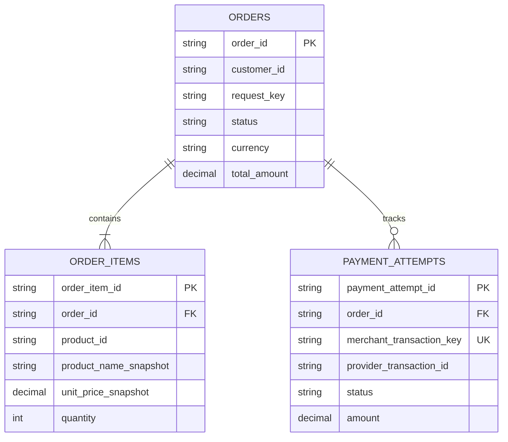

# 데이터 모델링과 소유권: 주문 데이터의 의미와 변경 책임

| 항목 | 내용 |
|---|---|
| 버전 | v0.1 |
| 상태 | 초안 |
| 수정일 | 2026-11-09 |
| 작성자 | Codex |

## 목차

1. [모델과 소유권을 함께 정하는 이유](#모델과-소유권을-함께-정하는-이유)
2. [개념 모델에서 물리 모델까지](#개념-모델에서-물리-모델까지)
3. [주문 예제의 논리 모델](#주문-예제의-논리-모델)
4. [누가 원본을 변경하는가](#누가-원본을-변경하는가)
5. [무결성과 트랜잭션 경계](#무결성과-트랜잭션-경계)
6. [조회와 데이터 수명주기](#조회와-데이터-수명주기)
7. [설계 완료 점검](#설계-완료-점검)
8. [관련 문서와 근거](#관련-문서와-근거)

## 모델과 소유권을 함께 정하는 이유

데이터 모델은 어떤 정보를 어떤 관계로 저장하는지 설명합니다. 소유권은 그 정보의 의미와 변경 규칙을 누가 책임지는지 설명합니다. 테이블 구조만 정하고 변경 책임을 비워 두면 여러 기능이 같은 값을 각자 수정하면서 규칙이 달라질 수 있습니다.

**원본, 변경 책임, 복사본의 용도를 함께 기록하는 것이 이 문서의 핵심입니다.** 데이터베이스 제품이나 샤딩 방식을 선택하기 전에, 어떤 사실을 저장하며 어느 시점의 값을 의미하는지부터 정리합니다.

이 문서는 [전체 흐름 설계](<../../solution/[draft]03-end-to-end-design.md>)와 같은 가상의 주문·결제 예제를 사용합니다. 하나의 백엔드와 관계형 데이터베이스 안에 주문 모듈과 결제 연계 모듈이 있으며, 외부 결제 사업자는 별도 시스템이라고 가정합니다.

## 개념 모델에서 물리 모델까지

같은 데이터를 세 수준에서 살펴보면 업무 의미를 놓치지 않으면서 구현까지 구체화할 수 있습니다. 아래 구분은 문서 작성에 사용하는 설명 틀입니다.

| 수준 | 답할 질문 | 주문 예제의 결과 |
|---|---|---|
| 개념 모델 | 업무에서 구분해야 할 대상과 관계는 무엇입니까? | 사용자가 주문하고, 주문에는 항목이 있으며, 결제 시도를 기록합니다. |
| 논리 모델 | 각 대상의 식별자·속성·관계·업무 제약은 무엇입니까? | 주문 ID, 사용자 ID, 요청 키, 주문 상태와 주문 항목 관계를 정합니다. |
| 물리 모델 | 선택한 저장소에서 어떻게 표현하고 조회합니까? | 테이블·컬럼 형식, 키, 제약조건, 인덱스와 접근 권한을 정합니다. |

업무 용어도 함께 정의합니다. 이 예제의 ‘주문 확정’은 검증된 결제 승인 결과를 내부 주문에 반영한 상태이며, 배송 완료나 정산 완료를 뜻하지 않습니다. 같은 상태 이름을 여러 업무에서 다르게 사용하지 않도록 의미를 먼저 합의합니다.

## 주문 예제의 논리 모델

이 관계도는 핵심 속성만 표시한 논리 모델입니다. `string`과 `decimal`은 의미를 나타내며 실제 SQL 형식은 아닙니다. 통화별 정밀도, 시간 컬럼과 개인정보 항목 등은 구현 전에 별도로 확정합니다.

| 대상 | 저장하는 사실 | 핵심 설계 조건 |
|---|---|---|
| `orders` | 특정 사용자가 제출한 주문과 현재 상태 | 사용자·요청 키 조합은 유일하며, 원래 요청과의 일치 여부를 확인할 정보를 보관합니다. |
| `order_items` | 주문 시점에 구매한 상품·가격·수량 | 상품의 현재 정보와 주문 당시의 정보가 구분되어야 합니다. |
| `payment_attempts` | 결제 승인 요청과 확인된 결과 | 같은 시도를 재처리할 때 같은 거래 키를 사용합니다. |

### 현재 값과 거래 당시 값을 구분합니다

상품 마스터의 가격이 바뀌어도 과거 주문 금액은 바뀌면 안 됩니다. 그래서 상품 ID를 참조하면서 주문 당시 상품명과 단가를 스냅샷으로 보존합니다. 이 복사는 조회를 빠르게 하기 위한 캐시가 아니라 거래 당시 사실을 기록하기 위한 모델 선택입니다.

이 예제에서는 할인·세금·배송비를 제외하므로 주문 총액은 항목별 `단가 × 수량`의 합입니다. 실제 업무에 할인이나 반올림이 들어가면 계산 기준과 적용 순서를 추가하고, 금액을 이진 부동소수점으로 처리하지 않도록 형식과 단위를 정해야 합니다.

### 요청 키와 거래 키를 구분합니다

요청 키는 사용자의 주문 제출이 중복되었는지 판별하는 키입니다. 결제 거래 키는 특정 결제 시도를 외부 사업자에게 식별시키는 키입니다. 두 키의 목적과 유효 범위가 다르므로 서로 바꿔 사용하지 않습니다.

같은 주문 요청 키에 다른 상품이나 수량이 들어오면 기존 주문으로 조용히 처리하지 않고 충돌을 알립니다. 이를 위해 최초 요청의 비교 가능한 표현이나 정규화된 요청 지문을 보관합니다. 단순 JSON 문자열 비교를 사용할 경우 필드 순서 등 표현 차이를 먼저 처리해야 합니다.

## 누가 원본을 변경하는가

소유 모듈은 해당 데이터의 의미와 변경 규칙을 책임집니다. 같은 데이터베이스를 사용하더라도 다른 모듈이 테이블을 직접 갱신하지 않고 소유 모듈의 작업을 호출하도록 경계를 정할 수 있습니다.

| 데이터 | 원본과 변경 책임 | 다른 기능에서 사용하는 방법 |
|---|---|---|
| 주문·주문 항목 | 주문 모듈이 생성·상태 전이·금액 규칙을 관리합니다. | 주문 조회와 상태 변경 작업을 호출합니다. |
| 결제 시도와 내부 반영 기록 | 결제 연계 모듈이 거래 키, 확인 결과, 재처리 정보를 관리합니다. | 확인된 결과를 주문 모듈에 전달합니다. |
| 실제 외부 승인·취소 결과 | 외부 결제 사업자의 거래 기록을 계약에 따라 확인합니다. | 진위가 검증된 응답·알림 또는 거래 조회로 내부 기록과 맞춥니다. |
| 조회용 캐시·분석용 복사본 | 원본에서 파생하며 갱신·재생성 책임을 따로 정합니다. | 원본을 대체해 수정하지 않고 목적과 허용 지연을 명시합니다. |

이 예제는 단일 데이터베이스에서 모듈의 책임을 나눈 구성입니다. 향후 서비스를 분리한다면 저장소 접근과 트랜잭션 경계도 다시 검토해야 합니다. 서비스별 데이터 소유권을 분리하는 방식과 그에 따른 연계 조회·트랜잭션의 어려움은 [AWS Database-per-service 안내](https://docs.aws.amazon.com/prescriptive-guidance/latest/modernization-data-persistence/database-per-service.html)에서 확인할 수 있습니다.

## 무결성과 트랜잭션 경계

업무 코드가 검사하더라도 데이터베이스가 보장할 수 있는 조건은 제약조건으로 표현합니다. PostgreSQL의 기본 키·외래 키·유일성·CHECK 제약은 [공식 제약조건 문서](https://www.postgresql.org/docs/current/ddl-constraints.html)에 설명되어 있습니다.

| 조건 | 예제에서 적용할 방법 |
|---|---|
| 주문과 항목의 식별자는 중복되지 않습니다. | 기본 키를 둡니다. |
| 항목과 결제 시도는 존재하는 주문에 속합니다. | 같은 데이터베이스 안에서 외래 키로 연결합니다. |
| 같은 사용자의 같은 요청은 하나의 주문입니다. | 사용자 ID와 요청 키를 필수값으로 두고 복합 유일성 제약을 둡니다. |
| 결제 시도의 거래 키는 중복되지 않습니다. | 거래 키를 필수값으로 두고 유일성 제약을 둡니다. |
| 수량은 양수이며 금액은 허용 범위 안에 있습니다. | 필수값·범위 제약과 업무 규칙을 함께 적용합니다. |
| 주문은 항목을 하나 이상 가집니다. | 주문 생성 작업에서 확인하고 항목과 함께 저장합니다. 외래 키만으로는 보장되지 않습니다. |
| 주문 총액과 항목 합계가 일치합니다. | 서버에서 계산하고 같은 트랜잭션에서 저장합니다. 단순 행 단위 CHECK에 다른 행의 합계를 맡기지 않습니다. |

### 함께 저장할 범위

주문 생성에서는 주문, 주문 항목, 최초 결제 시도를 하나의 트랜잭션으로 저장합니다. 승인 결과를 반영할 때도 내부 결제 기록과 주문 상태를 함께 갱신합니다. 주문 모듈과 결제 모듈은 각자의 변경 규칙을 수행하고, 사용 사례의 조정 코드가 공통 트랜잭션을 관리하는 구성입니다.

외부 결제 승인까지 이 트랜잭션에 포함되는 것은 아닙니다. 내부 커밋과 외부 승인의 시점이 다르므로, 저장된 시도 기록과 거래 조회를 이용한 복구 흐름이 필요합니다. 이 경계는 [전체 흐름 설계](<../../solution/[draft]03-end-to-end-design.md#실패와-중복-요청-처리>)에 연결합니다.

### 동시 실행을 가정합니다

먼저 조회해 중복이 없다는 사실만 확인하면, 동시에 들어온 두 요청이 모두 주문을 만들 수 있습니다. 유일성 제약으로 최종 충돌을 판별하고 충돌한 요청은 기존 주문을 읽어 최초 요청과 비교하도록 처리합니다.

주문 상태를 바꿀 때도 현재 상태를 조건으로 갱신하거나 버전 검사를 적용하여 오래된 결과가 새 상태를 덮어쓰지 않게 합니다. 선택한 데이터베이스의 격리 수준, 잠금 방식, 충돌 시 재처리 정책은 실제 동시성 시나리오로 검증합니다.

## 조회와 데이터 수명주기

### 실제 조회 경로에서 인덱스를 검토합니다

| 조회 목적 | 후보 접근 경로 | 확인할 사항 |
|---|---|---|
| 주문 상세 | 주문 ID 기본 키, 항목의 주문 ID | 항목 수와 실제 실행 계획을 확인합니다. |
| 사용자 주문 목록 | 사용자 ID와 생성 시각 | 정렬·페이지 처리 방식과 기간 조건을 함께 검토합니다. |
| 결제 미완료 복구 | 시도 상태와 마지막 시도 시각 | 실행 주기, 대상 건수, 여러 작업자의 중복 처리를 검토합니다. |

표는 인덱스 후보이며 확정된 성능 개선 결과가 아닙니다. 데이터 분포와 실제 쿼리로 확인하고, 조회 이점뿐 아니라 쓰기 비용도 비교합니다. 외래 키를 선언했다는 이유만으로 참조하는 컬럼의 인덱스가 항상 자동 생성된다고 가정하지 않습니다.

### 보존과 복구의 책임을 남깁니다

- [확인 필요] 주문·결제 기록과 개인정보의 보존 기간 및 삭제 기준을 업무·정책 담당자와 정합니다.
- 개인정보 원본과 거래 이력에 남길 스냅샷의 범위를 구분하고, 삭제·익명화가 조회와 감사에 미치는 영향을 기록합니다.
- 캐시나 분석 데이터에는 원본 식별자와 갱신 기준을 남기고, 오류가 나면 재생성할 수 있는지 확인합니다.
- 백업 존재 여부뿐 아니라 복원된 주문·항목·결제 기록의 연결과 외부 결과의 대사 방법을 확인합니다.

## 설계 완료 점검

- 주요 용어와 상태가 업무 담당자가 이해하는 의미와 일치합니다.
- 현재 정보와 거래 당시 정보가 구분되어 있습니다.
- 각 데이터의 원본과 변경 책임, 복사본의 용도를 설명할 수 있습니다.
- 필수값·관계·유일성·금액 규칙을 어느 계층이 보장하는지 정했습니다.
- 중복 요청, 동시 갱신과 외부 결과 유실을 검토했습니다.
- 조회·보존·삭제·복구 요구를 모델에 연결했습니다.

## 관련 문서와 근거

- [전체 흐름 설계](<../../solution/[draft]03-end-to-end-design.md>): 데이터가 생성·변경되는 업무 흐름과 장애 복구를 설명합니다.
- [계층형 구조](<../application/application-structure/[draft]01-layered.md>): 데이터 접근과 업무 규칙을 코드 책임으로 구분합니다.
- [PostgreSQL 제약조건](https://www.postgresql.org/docs/current/ddl-constraints.html): 무결성 제약의 기능과 한계를 확인하는 근거입니다.
- [AWS Database-per-service](https://docs.aws.amazon.com/prescriptive-guidance/latest/modernization-data-persistence/database-per-service.html): 서비스를 분리할 때 데이터 소유권과 연계 복잡성을 검토하는 자료입니다.

[데이터 아키텍처 안내](README.md) · [전체 문서 안내](../../README.md)
